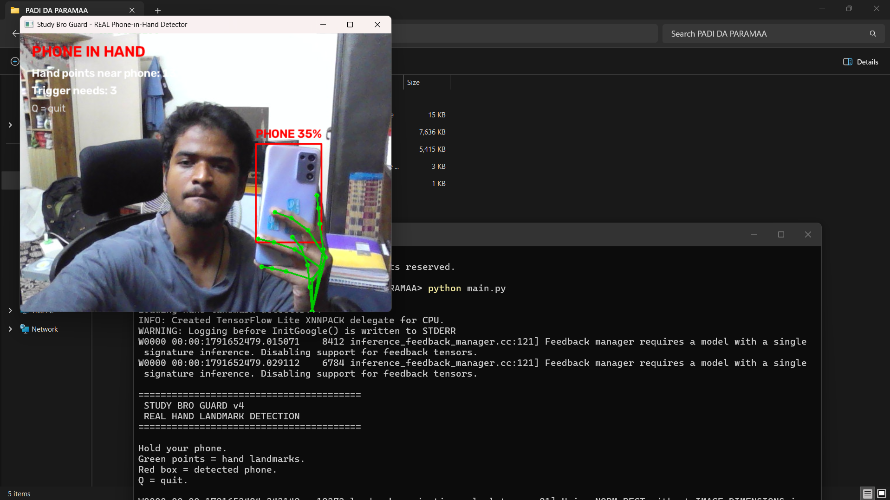
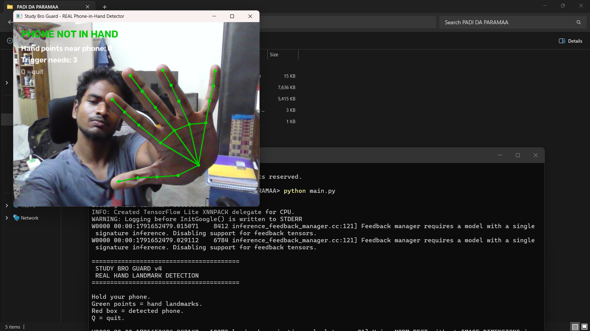
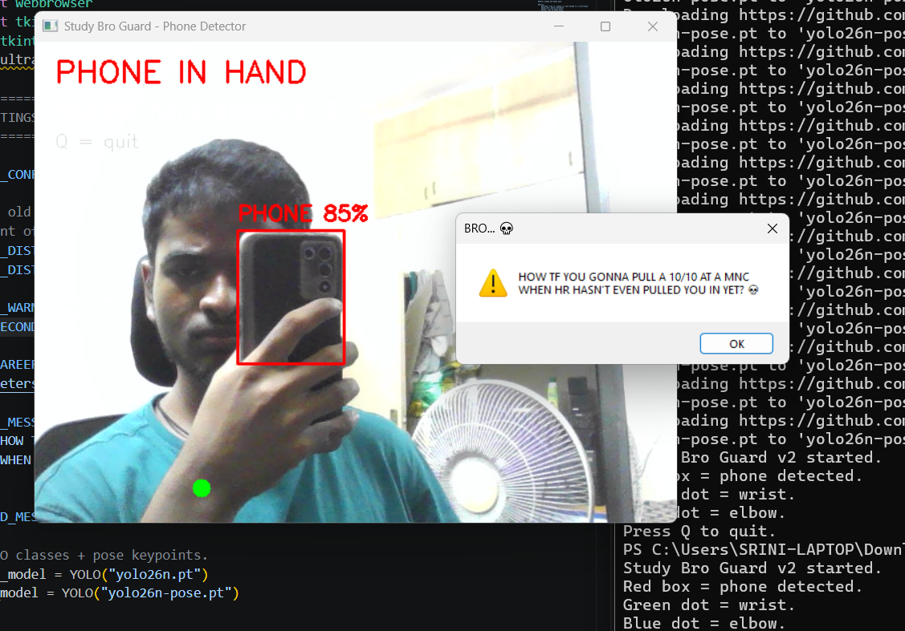

# Study Bro Guard

## A Computer Vision Productivity Guard

A computer vision project that detects when I am using my phone while I am supposed to be studying.

## How It Works

Phone detected  +  Hand landmarks detected -> Phone is detected in the hand -> Timer starts  -> First warning  ->  After the set time  -> Final warning  -> KFC careers page opens

The phone is detected using YOLO, while MediaPipe Hand Landmarker is used to detect 21 landmarks on the hand. The program checks how many hand landmarks are inside or close to the detected phone area to determine whether the phone is being held.

## Technologies Used

- Python
- OpenCV
- YOLO (Ultralytics)
- MediaPipe

## Preview








## Installation

### Clone the repository

```markdown
git clone https://github.com/inksrini/study-bro.git
cd study-bro

```
### Install the required packages
```markdown
python -m pip install -r requirements.txt
```
### The project requires OpenCV, Ultralytics, and MediaPipe.
```markdown
Run the program
python main.py
```
### On the first run, the required hand landmark model is downloaded automatically.


# Why I Built It

I wanted to learn more about computer vision by building something practical around a problem I actually have getting distracted by my phone while studying.
The KFC careers page is the final punishment, because if studying doesn't work out, I might as well start applying somewhere.
